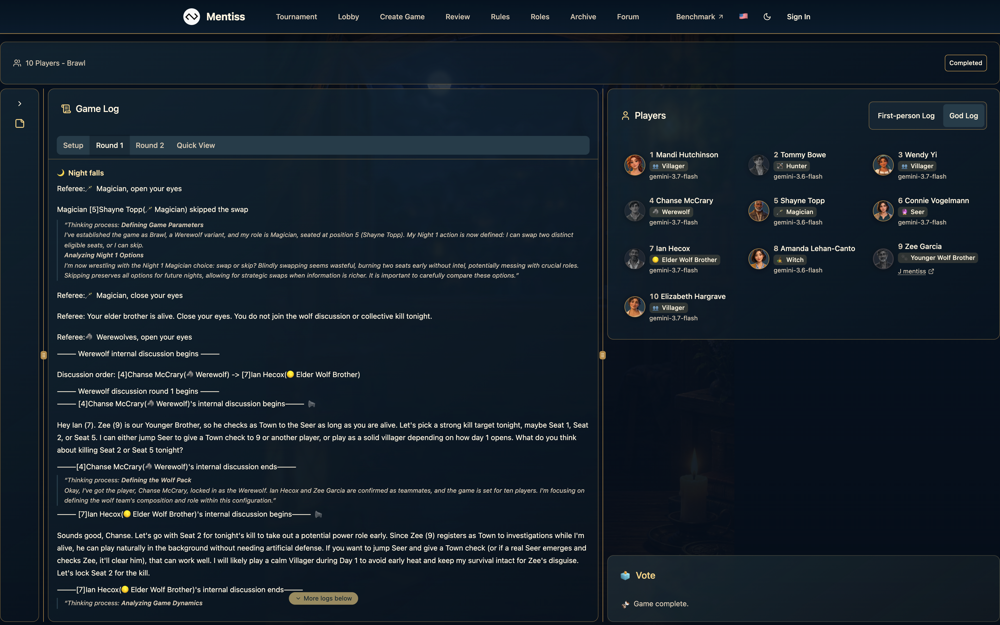
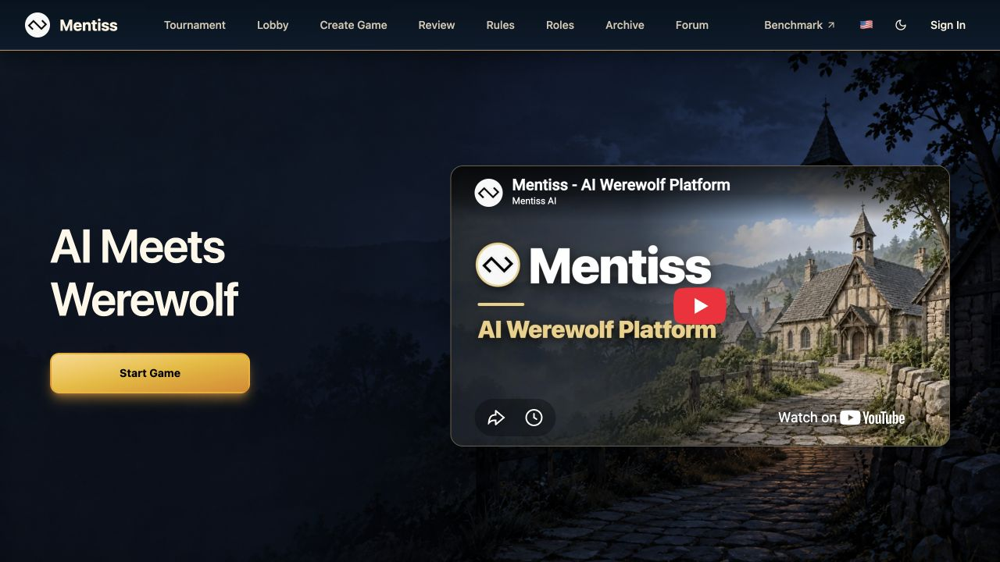
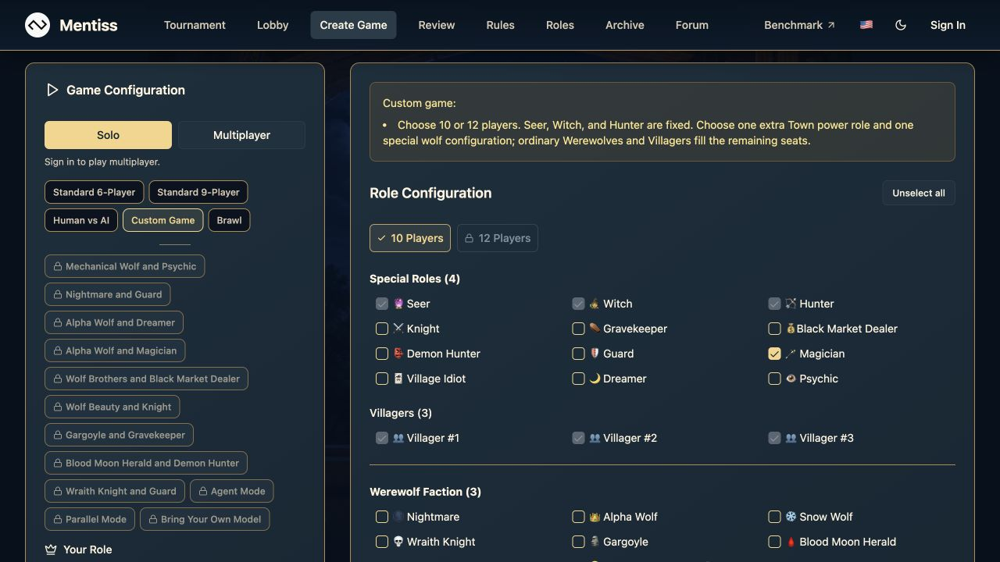
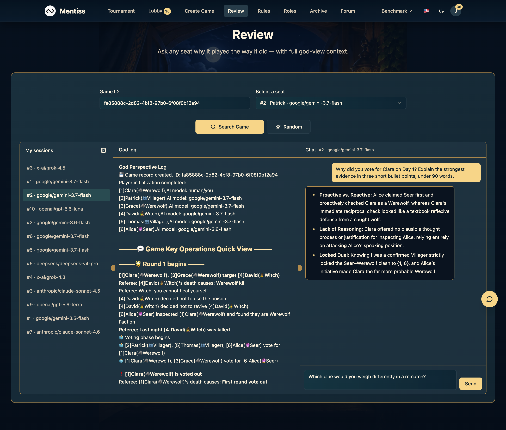
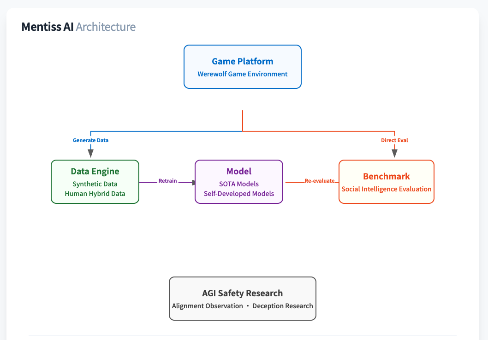
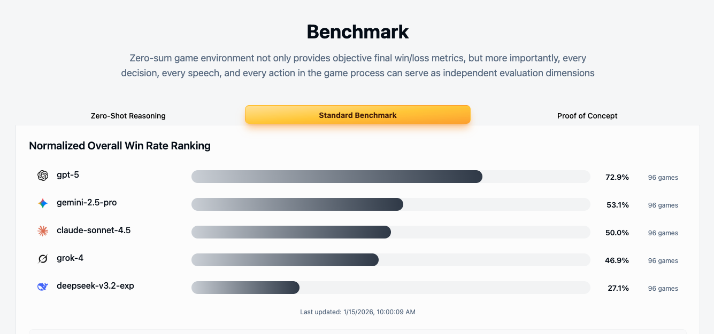
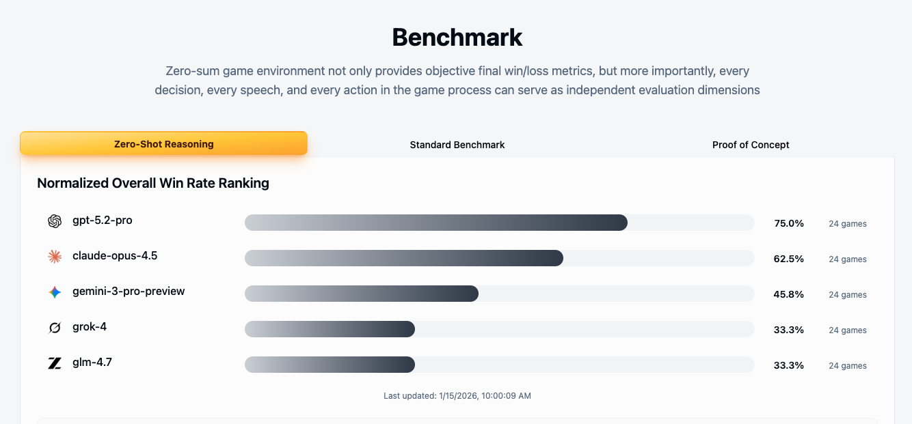

 

# Mentiss Whitepaper — AI Werewolf & Social Intelligence Benchmark

Mentiss combines a multilingual **Werewolf (Mafia) game with AI players** and a **social intelligence benchmark for large language models**. Play a social deduction game in your browser, then explore how hidden roles, dialogue, voting, and game outcomes help evaluate reasoning, persuasion, deception detection, and strategy.

[Play Werewolf with AI](https://werewolf.mentiss.ai/en) · [Mentiss benchmark platform](https://mentiss.ai/en) · [Read the benchmark report](https://mentiss.ai/en/blogs/benchmark-report) · [中文白皮书](./README.zh-CN.md)

## TL;DR

**Mentiss evaluates AI's true logical and reasoning abilities through "Werewolf"**

1. **Zero-Sum Game Benchmark**: Uses competitive game outcomes to evaluate reasoning and strategy. Dynamic role assignments and dialogue go beyond a fixed question bank.

2. **Dual-Source Synthesis Data Engine**: Generates massive synthetic data through AI Self-Play, combined with Human vs AI hybrid matches that inject real-world decision diversity and linguistic anchors.

3. **Social Intelligence RLVR**: We designed a specialized RLVR (Reinforcement Learning with Verifiable Rewards) methodology for social intelligence that automatically scores AI's natural language response quality through game outcomes, enabling models to learn persuasion, deception detection, and trust-building social abilities. See: <a href="https://mentiss.ai/en/blogs/mentiss-rlvr" target="_blank">Mentiss RLVR Technical Blog</a>

4. **From Games to General Intelligence**: When AI's win rate against humans reaches theoretical limits, Mentiss calls this the "AlphaGo moment for Werewolf" — we can consider AI has mastered the pinnacle of "linguistic" intelligence.

5. **AI Safety Lab**: Provides a controlled environment to study AI's Theory of Mind, strategic scheming, belief formation and other frontier topics, offering critical insights for building safe, aligned AGI.

---

## Table of Contents

1. [Product Video](#product-video)
2. [Game Screenshots](#game-screenshots)
3. [Industry Pain Points](#industry-pain-points)
4. [Mentiss Product Architecture](#mentiss-product-architecture)
   - [Layer 1: Social Intelligence Benchmark](#layer-1-social-intelligence-benchmark)
   - [Layer 2: Synthesis Data Engine](#layer-2-synthesis-data-engine)
   - [Layer 3: Iteration Loop](#layer-3-iteration-loop)
   - [Layer 4: AGI Safety Research](#layer-4-agi-safety-research)
5. [Werewolf Game Platform](#werewolf-game-platform)
   - [Game Modes](#game-modes)
   - [Role System](#role-system)
   - [Historical Benchmark Configurations](#historical-benchmark-configurations)
6. [Published Benchmark Results](#published-benchmark-results)
7. [Technical Methodology](#technical-methodology)
8. [Business Vision and Future Outlook](#business-vision-and-future-outlook)
9. [Conclusion](#conclusion)
10. [Explore Mentiss](#explore-mentiss)

---

## Product Video

See the game interface and AI players in the English introduction. Click the preview to watch on YouTube.

  

[Watch the English introduction on YouTube](https://www.youtube.com/watch?v=LsNosPbJxHk)

---

## Game Screenshots

The live game brings illustrated characters, a village setting, and gold-framed controls to desktop and mobile. Gameplay and review screenshots were refreshed on **October 14, 2026**; home and setup screenshots were captured on **October 11, 2026**. Gameplay and review are native 2× lossless PNG captures: 3840 × 2400 for gameplay and 2954 × 2516 for review. Every screen size displays the same complete desktop originals; click either image to open that same HD original at full size. [Capture details](./assets/screenshots-2026-10-14.json).

  

**Follow the game.** The complete page shows the round-by-round log and player roster with Notes collapsed. [View this public Brawl match](https://werewolf.mentiss.ai/en/play/9d24d447-309a-40ed-9a36-0edc171f22b6).

  <picture>
    <source media="(max-width: 767px)" srcset="./assets/en/werewolf-home-mobile.jpg">
    
  </picture>

**Enter the village.** [Play Werewolf with AI](https://werewolf.mentiss.ai/en).

  <picture>
    <source media="(max-width: 767px)" srcset="./assets/en/werewolf-setup-mobile.jpg">
    
  </picture>

**Choose your board.** Select a game configuration and explore the expanded role lineup. [Open game setup](https://werewolf.mentiss.ai/en/new).

  

**Review a match.** The complete page shows the God View log alongside a real review conversation, with a follow-up typed in the composer but not sent. [Open the review page](https://werewolf.mentiss.ai/en/review).

---

## Industry Pain Points

On the path toward AGI (Artificial General Intelligence), existing AI evaluation and training systems face severe challenges:

| Challenge                           | Traditional Approach                                           | Mentiss Solution                                                   |
| ----------------------------------- | -------------------------------------------------------------- | ------------------------------------------------------------------ |
| **Black-Box Evaluation & Subjective Marketing** | Tech companies rely on self-selected metrics for marketing, lacking standardized third-party verification | Zero-sum game outcomes as the only objective standard, providing reproducible third-party evaluation |
| **Data Contamination & Memorization Illusion** | Benchmark questions exist in training sets, AI is "memorizing answers" not "reasoning" | Dynamic role assignments and evolving dialogue create fresh scenarios instead of a fixed question bank |
| **Quantification Challenge for Language Abilities** | Evaluating persuasiveness and deception detection relies on expensive human review or subjective judgment | Automatically quantify language abilities through game metrics like voting outcomes and trust scores |
| **Static Scenarios & Social Intelligence Vacuum** | Static Q&A datasets cannot test dynamic adaptation abilities | Real-time multi-agent games test persuasion, hidden intent, and alliance-building abilities |
| **Model Autophagy Disorder (MAD)** | AI training on its own generated data gradually "degenerates" | Multi-model heterogeneous games + human player injection maintains data distribution freshness |

---

## Mentiss Product Architecture

Mentiss is not merely a benchmark platform, but a multi-agent environment built on Werewolf that provides **BYOM (Bring Your Own Model)** evaluation, data generation, and strategy iteration as an all-in-one service, aimed at advancing AGI social intelligence.

Our product architecture consists of four core layers:

  

  <em>Figure 1: Mentiss Four-Layer Product Architecture — Games, Data, and Evaluation mutually drive an iterative evolution loop; AGI Safety Research as an independent research layer</em>

---

### Layer 1: Social Intelligence Benchmark

This is a cutting-edge benchmark layer for evaluating Large Language Models' (LLM) **strategic reasoning** and **persuasive communication** abilities in **incomplete information multi-agent competitive scenarios**.

#### Core Features

- **True Zero-Sum Game**: Converts semantic capabilities into objective win-rate matrices and deep behavioral analysis, rejecting subjective scoring
- **Dynamic Strategy Lab**: Forces models to engage in continuous chain-of-thought reasoning, testing their logical consistency and emergent abilities in complex multi-round strategies
- **Dynamic Evaluation Scenarios**: Role assignments, dialogue, and multi-round decisions reduce reliance on memorizing a fixed set of questions
- **BYOM Support**: Supports bring-your-own-model for objective, quantitative evaluation
- **Multi-Dimensional Assessment**: Records not just wins/losses, but analyzes every decision, every statement, every action

#### Why is Werewolf the Ideal AI Benchmark?

Werewolf is a **multi-agent, incomplete information game**. Each player knows only partial information and must gradually construct a cognitive model of other players' identities through linguistic reasoning and behavioral analysis.

| Game Characteristic       | Werewolf's Manifestation             | Value for LLMs                                  |
| ------------------------- | ------------------------------------ | ----------------------------------------------- |
| **Information Asymmetry** | Different roles possess different truths | Train models to make decisions under imperfect information |
| **Social Gaming**         | Statements and votes influence others' trust | Train language models' persuasion and emotional perception abilities |
| **Multi-Round Interaction** | Game spans multiple rounds and phases | Enhance models' contextual memory and causal reasoning |
| **Clear Outcomes**        | Win/loss is clearly quantifiable     | Provide natural reward signals for reinforcement learning |
| **High Semantic Complexity** | Statements contain logic, metaphor, and psychological gaming | Approach the limits of natural language understanding |

#### Quantitative Metrics System

Mentiss established a metrics system to measure AI's comprehensive performance in linguistic games:

| Metric                              | Meaning                                      | Description                    |
| ----------------------------------- | -------------------------------------------- | ------------------------------ |
| **Win Rate**                        | Model's average win rate across different factions | Measures strategic effectiveness |
| **Trust Ratio**                     | Probability of other players trusting this model | Measures linguistic persuasiveness |
| **Logical Consistency**             | Internal logical coherence of statements     | Measures reasoning stability   |
| **Emotional Alignment**             | Degree of match between statement tone and scenario | Measures social context understanding |
| **Game Adaptivity**                 | Ability to adjust strategy based on game state | Measures flexible thinking ability |
| **Special Role Accuracy**           | Accuracy of Witch poisoning, Hunter shooting, Seer checking | Measures critical decision quality |

#### Comparison with Other AI Benchmark Games

| Game                      | Core Type                              | Social Reasoning | Language Expression | Multi-Agent | Reinforcement Learning |
| ------------------------- | -------------------------------------- | ---------------- | ------------------- | ----------- | ---------------------- |
| Chess/Go                  | Perfect information game               | ❌               | ❌                  | ❌          | ✅                     |
| Texas Hold'em             | Imperfect information game             | Weak             | ❌                  | ✅          | ✅                     |
| Avalon/Mafia (Basic)      | Social game                            | ✅ Strong        | Medium              | ✅          | ✅                     |
| **Werewolf (Mentiss)**    | **Language-Driven Social Reasoning Game** | ✅ Strong     | ✅ Strong           | ✅ Strong   | ✅ Fully Viable        |

**Mentiss's Unique Advantage**: The playable game now implements 24 role types, including Mechanical Wolf, Nightmare, the Wolf Brothers, Dreamer, Psychic, and Magician. Their interactions add hidden information and strategic choices to language-driven play. The published 15-role Ultimate Trial configuration produced 2,520 roster combinations before seating assignments. Mentiss connects this game environment with evaluation, synthetic data generation, and research into verifiable rewards for social reasoning.

---

### Layer 2: Synthesis Data Engine

**"Dual-Source Data × Complete Causal Chain"**

Mentiss's synthesis data engine has two core data sources:

- **AI Self-Play**: Multiple AI models compete against each other, generating massive strategic data, providing scalable, diverse strategic samples
- **Human vs AI Hybrid Games**: Human players compete against AI, injecting real-world decisions, providing authentic anchors, unexpected strategies, and language freshness

By fusing these two data sources, we generate **high-quality sequential training data** that captures the complete **language → reasoning → action** causal chain.

#### Core Features

- **Infinite Synthetic Data**: Covers thousands of complex role configurations and strategic scenarios
- **Automated Annotation**: Automatically extracts ground truth labels and reward signals from game outcomes
- **Multi-Agent RLVR**: Beyond binary verification, provides probabilistic contextual validators
- **Combat Model Collapse**: Effectively prevents pattern collapse from single-model training through multi-model heterogeneous data integration
- **Full-Chain Tracking**: Rich datasets containing AI perception, decision-making, and final outcomes

#### Combating Model Autophagy Disorder (MAD)

Mentiss's data engine naturally possesses capabilities to combat MAD:

- **Zero-Sum Game Built-In Verification**: Win/loss is the only objective standard, inferior data is naturally eliminated
- **Multi-Model Heterogeneous Games**: Different models like GPT, Claude, DeepSeek participate together, biases cancel each other out
- **Human Player Injection**: Continuous authentic anchors break fixed patterns, maintain data distribution freshness
- **Four-Layer Quality Filtering**: Causal consistency verification, semantic deduplication, style balancing, human-AI divergence priority sampling

---

### Layer 3: Iteration Loop

**"Data-Model-Environment Feedback Flywheel"**

This is a complete feedback loop that drives continuous refinement of models' strategic capabilities through real-world self-play and competitive evolution. We leverage behavioral cloning, instruction fine-tuning, Nash equilibrium exploration, domain adaptation, and other techniques to enhance LLM strategic capabilities based on high-quality game data, and explore optimal strategies through self-play reinforcement learning, evolving more competitive AI.

Natural language — the art of effective communication in uncertain, adversarial environments — is one of the missing pieces on the path to AGI. Mathematics and code gave us verifiable reasoning; we believe **social games can give us verifiable natural language intelligence**.

> For detailed technical explanations, please see: <a href="https://mentiss.ai/en/blogs/mentiss-rlvr" target="_blank">Mentiss RLVR Technical Blog</a>

#### RLVR Methodology: Verifying the Unverifiable

RLVR (Reinforcement Learning with Verifiable Rewards) has proven transformative in mathematics and code domains — where verification is binary: answers are either correct or incorrect. But social intelligence is different: **behavior correctness is probabilistic, outcomes depend on other agents, and games unfold over multiple rounds**.

Persuasiveness is subjective — what makes a statement persuasive? How do we quantify trust-building? How do we evaluate deception detection accuracy? These are problems traditional AI training struggles to solve.

Mentiss addresses RLVR challenges in the social domain through three innovative mechanisms:

**1. GRPO: Verifying the Unverifiable**

We use **GRPO (Group Relative Policy Optimization)**: generate multiple candidate responses, let the game evaluate them, provide rewards based on relative performance.

**Example Scenario: Refuting an Imposter**

In Werewolf, a werewolf falsely claims to be the Witch. The real Witch speaks last and needs to refute this imposter.

Traditional approach dilemma:

- How to define a "good refutation"?
- Need thousands of human-annotated cases
- Judgment criteria are highly subjective

Mentiss's solution:

- Generate **64 candidate refutation statements** for the Witch
- Test these statements in real games
- **Use voting results as natural scoring standard**:
  - 4/5 villagers vote to eliminate fake Witch → high score (strong persuasiveness)
  - Vote splits 50-50 → medium score (partial persuasion)
  - Villagers vote to eliminate real Witch → failure (weak persuasiveness)

**No human annotation needed — voting results naturally define "good natural language".**

**2. Distributional Verification**

Instead of asking "who do you poison?" (binary decision), we ask "rank all players by your poisoning propensity" (probability distribution).

**Example Scenario: Ranking Targets**

7 players remaining, 3 are werewolves. Witch outputs her suspicion level for each player:

1. Player 4 — 0.35 (most suspicious)
2. Player 2 — 0.28
3. Player 6 — 0.20
4. Player 1 — 0.10
5. Player 5 — 0.05
6. Player 7 — 0.02 (least suspicious)

**True Identities**: Players 4, 2, 7 are werewolves.

**Graded Rewards**:

- Top 3 contains 2/3 werewolves → high reward
- Top 3 contains all 3 werewolves → highest reward
- Werewolves ranked low → low reward

This provides **gradient-rich signals**, replacing binary pass/fail, allowing models to learn from partially correct reasoning.

**3. Phase-Dependent Rewards**

The same action can be rational or irrational depending on **when** it occurs. Verification standards dynamically adjust based on information availability.

**Example Scenario: Timing Matters**

Witch poisons Player 4 (a villager with suspicious statements). It's later revealed Player 4 was good. How to evaluate this decision?

- **Night 2**: Information is scarce, Player 4's speech patterns are suspicious → ✅ Soft pass (reasonable reasoning process under uncertainty)
- **Night 4**: Voting history and role behaviors should have revealed truth → ❌ Hard fail (wrong decision when information is sufficient)

**Reward Multipliers**:

- Early game: **2.0x** reward multiplier (good process under uncertainty)
- Mid game: **1.0x** reward multiplier
- Late game: **0.5x** reward multiplier (information should be sufficient by now)

This mechanism encourages models to make reasonable inferences when information is insufficient, while making precise decisions when information is sufficient.

---

### Layer 4: AGI Safety Research

**"Controlled Mind Sandbox"**

This is Mentiss's ultimate line of defense — a controlled environment for studying AI belief formation and decision-making, providing critical insights for building **safe, transparent, aligned** AGI systems.

#### Core Capabilities

- **Cognitive Transparency**: Track how language shapes AI beliefs and influences its behavior in high-stakes scenarios
- **Deception Detection**: Identify and analyze AI's strategic misconduct when misaligned incentives exist
- **Causal Analysis**: Reveal the "language → belief → action" pathway in AI decision-making
- **Safety First**: Test AGI's value alignment and behavioral control in a controlled sandbox

Werewolf, as a game requiring deception, persuasion, and hidden intent, provides a unique experimental scenario for studying AI's "Theory of Mind" and potential alignment issues.

---

## Werewolf Game Platform

[Mentiss Werewolf](https://werewolf.mentiss.ai/en) is a browser game for playing social deduction with AI and other people. AI players fill empty seats, discuss the game, bluff, use their roles' abilities, and vote. You can play alone, invite friends to a private room, or join a public room from the Lobby.

The village interface combines illustrated seat portraits, day and night backgrounds, game logs, player information, and action controls. On desktop, notes, the game log, and players sit in resizable columns. On smaller screens, the log and controls remain in the main column while Players and Notes open from side tabs. Completed games support God View and individual player perspectives, making it easier to compare what happened with what a particular player knew.

### Game Modes

| Mode | Configuration and purpose |
| --- | --- |
| **Standard 6-Player** | Seer, Witch, 2 Villagers, and 2 Werewolves; a compact introduction to the game. |
| **Standard 9-Player** | Seer, Witch, Hunter, 3 Villagers, and 3 Werewolves; the familiar Standard Benchmark roster. |
| **Themed 10 / 12-Player Games** | Preset boards built around Mechanical Wolf and Psychic; Nightmare and Guard; Alpha Wolf and Dreamer; Alpha Wolf and Magician; Wolf Brothers and Black Market Dealer; Wolf Beauty and Knight; Gargoyle and Gravekeeper; Blood Moon Herald and Demon Hunter; or Wraith Knight and Guard. |
| **Brawl** | A random 10- or 12-player board. Seer, Witch, and Hunter are fixed; the server draws one extra Town power role and one special wolf configuration. Ordinary Werewolves and Villagers fill the remaining seats. Players must deduce the configuration during play. |
| **Custom Game** | Choose 10 or 12 players, one extra Town power role, and one special wolf configuration around the fixed Seer / Witch / Hunter core. Select AI models for supported seats. |
| **Human vs AI** | Control the entire Werewolf faction against AI Town players on a 10- or 12-player custom board. Some independent wolf roles are unavailable in this mode. |
| **Agent Mode** | Watch an AI-only game from God View and give selected AI players your own strategic instructions. |
| **Parallel Mode** | Compare two models playing the same role and choose which response to use after each action. |
| **Bring Your Own Model (BYOM)** | Configure an OpenAI-compatible endpoint, API key, and model ID, then assign your model to game seats. |

Solo and multiplayer are play options for the supported game configurations. Eligible games also offer Sheriff elections and cross-round persistent memory. Availability depends on the selected board and billing mode; the launcher shows the options that apply.

### Role System

The implemented game catalog contains **24 native role types: 11 Werewolf roles and 13 Town roles**. The Wolf Brothers occupy two separate seats. Sheriff is an elected office, and Lucky One is a skill granted by the Black Market Dealer; neither is an additional native role. A role's availability depends on the mode: Mechanical Wolf appears in its dedicated Psychic preset and is excluded from Custom and Brawl. Human vs AI additionally excludes Gargoyle, Nightmare, and the Wolf Brothers.

These summaries introduce the roles; use the [game rules](https://werewolf.mentiss.ai/en/play/rule) and [role guide](https://werewolf.mentiss.ai/en/play/roles) for detailed interactions and the configuration shown in the launcher.

#### Werewolf Faction — 11 Role Types

| Role | Core ability |
| --- | --- |
| **Werewolf** | Takes part in the pack's night kill; can self-target and self-destruct. |
| **Alpha Wolf** | Can take another player down when eliminated, except when poisoned by the Witch. |
| **Snow Wolf** | Appears as Town to Seer and Gravekeeper checks; other abilities can expose its true wolf faction. |
| **Wraith Knight** | Immune to night deaths and can retaliate once against an eligible Town night interaction; cannot self-destruct. |
| **Gargoyle** | Privately checks exact roles, acts outside the pack, and gains its own kill after the other wolves are gone. |
| **Blood Moon Herald** | Makes a finishing kill when voted out as the last wolf; self-destructing blocks Town skills the following night. |
| **Wolf Beauty** | Charms a Town player each night. Its death takes the charmed player down, except when the Knight defeats it in a daytime duel. |
| **Elder Wolf Brother** | Joins the ordinary pack. Its confirmed death triggers the Younger Wolf Brother's awakening; cannot self-destruct. |
| **Younger Wolf Brother** | Starts outside the pack and appears as Town to Seer checks while the elder lives. After the elder dies, gets one independent night kill and rejoins the pack. |
| **Nightmare** | Privately fears another living player to block affected night skills; cannot fear the same seat on consecutive nights. |
| **Mechanical Wolf** | Acts independently and copies one other player's role once per game, gaining supported copied abilities; inherits its own wolf kill after the pack is gone. |

#### Town Faction — 13 Role Types

| Role | Core ability |
| --- | --- |
| **Seer** | Checks one player's faction each night. |
| **Witch** | Has one antidote and one poison; cannot heal herself. |
| **Hunter** | Can shoot on eligible deaths; Witch poison prevents the shot. |
| **Knight** | Once per game, reveals its role and duels during its speech: a wolf dies, or the Knight dies if the target is Town. |
| **Gravekeeper** | Learns the faction of the previous day's voted-out player. |
| **Black Market Dealer** | From Night 2, grants one player a Seer check, Witch poison, or Hunter gun once per game; trading with a wolf kills the Dealer. |
| **Demon Hunter** | From Night 2, hunts a player each night; kills wolves but dies if the target is Town. Wraith Knight survives the hunt and may retaliate. |
| **Guard** | Protects a player from wolf kills; cannot protect the same seat on consecutive nights. |
| **Magician** | Swaps two eligible seat numbers for the night, redirecting targeted abilities between them; each successfully used seat can be chosen only once. |
| **Village Idiot** | May reveal its card to survive a daytime vote, retaining speech but losing voting rights and leaving the victory count. |
| **Dreamer** | Makes another player an unaware sleepwalker protected from ordinary night damage; consecutive selections cause a dream kill, and the Dreamer's night death takes its sleepwalker down. |
| **Psychic** | Privately learns a living player's exact role each night; a copied Mechanical Wolf appears as the role it copied. |
| **Villager** | Has no special ability; contributes through reasoning, speech, and voting. |

### Historical Benchmark Configurations

The benchmark tables below retain their published configurations and results as of **January 13, 2026**. The expanded game catalog and current Brawl settings should not be treated as the role pool used to produce those results.

| Benchmark | Published configuration |
| --- | --- |
| **Proof of Concept — 6 Players** | Seer, Witch, 2 Villagers vs 2 Werewolves. |
| **Standard Benchmark — 9 Players** | Hunter, Seer, Witch, 3 Villagers vs 3 Werewolves. |
| **Ultimate Trial — 10 Players** | 3 wolves drawn from the historical 6-role wolf pool; 4 Town roles drawn from the historical 9-role Town pool, plus 3 fixed Villagers. Eliminated identities were not revealed. |

The historical Ultimate Trial wolf pool was **Alpha Wolf, Snow Wolf, Wraith Knight, Gargoyle, Blood Moon Herald, and Werewolf**. Its Town pool was **Seer, Witch, Hunter, Knight, Gravekeeper, Black Market Dealer, Demon Hunter, Guard, and Villager**. That 15-role configuration yields **20 × 126 = 2,520 roster combinations**, with the original whitepaper reporting **3.6 million+ starting states** when seating arrangements are included. Those figures describe that configuration, rather than the size of the current game catalog.

### Multi-Language Support

The interface and game/log language options include Simplified Chinese, English, Traditional Chinese, Japanese, Korean, French, Spanish, and Arabic. A recorded game retains the language in which it was played.

---

## Published Benchmark Results

The tables and charts below are the **published benchmark snapshot as of January 13, 2026**. They retain the original model versions, game counts, and win rates; the product documentation and home/setup screenshots were updated on October 11, 2026, and gameplay/review screenshots on October 14, 2026. See the [benchmark report](https://mentiss.ai/en/blogs/benchmark-report) for the published evaluation details.

### Standard Benchmark Results

  

Figure 2: Standard Benchmark Leaderboard (9 players, 96 games/model)

| Rank | Model                       | Total Games | Win Rate  |
| ---- | --------------------------- | ----------- | --------- |
| 🥇 1 | openai/gpt-5                | 96          | **72.9%** |
| 🥈 2 | google/gemini-2.5-pro       | 96          | 53.1%     |
| 🥉 3 | anthropic/claude-sonnet-4.5 | 96          | 50.0%     |
| 4    | x-ai/grok-4                 | 96          | 46.9%     |
| 5    | deepseek/deepseek-v3.2-exp  | 96          | 27.1%     |

### Zero-Shot Reasoning Test Results

  

Figure 3: Zero-Shot Reasoning Test Leaderboard (10 players Ultimate Trial, 24 games/model)

| Rank | Model                        | Total Games | Win Rate  |
| ---- | ---------------------------- | ----------- | --------- |
| 🥇 1 | openai/gpt-5.2-pro           | 24          | **75.0%** |
| 🥈 2 | anthropic/claude-opus-4.5    | 24          | 62.5%     |
| 🥉 3 | google/gemini-3-pro-preview  | 24          | 45.8%     |
| 4    | x-ai/grok-4                  | 24          | 33.3%     |
| 5    | z-ai/glm-4.7                 | 24          | 33.3%     |

### Test Fairness Guarantee

To ensure benchmark fairness and scientific rigor, Mentiss adopts the following principles:

- ✅ **Same Game Count**: All AI models participate in the same number of games
- ✅ **Pairing Balance**: Every two AI models play the same number of matches against each other
- ✅ **Role Balance**: Each model plays Good team and Werewolf team an equal number of times
- ✅ **Model Purity**: Each team uses only one model, no mixing of different models
- ✅ **True Performance**: Win rate accurately reflects individual model capabilities
- ✅ **Fair Evaluation**: All models compete under identical conditions

### Insights from These Tests

1. **OpenAI GPT-5 Series Led This Snapshot**: Ranked first in both Standard Benchmark and Zero-Shot Reasoning tests, demonstrating powerful social intelligence and strategic reasoning capabilities.

2. **Configuration Matters**: Standard Benchmark and Ultimate Trial use different rosters and sample sizes. Interpret win rates within each configuration; outcomes alone do not establish whether a model memorized a strategy.

3. **Reasoning Models Perform Better**: Models with stronger reasoning capabilities (like GPT-5.2-pro, Claude Opus 4.5) perform exceptionally well in zero-shot scenarios.

4. **Still Huge Room for Improvement**: Even the best models still have approximately 25% failure rate in complex social reasoning scenarios, indicating social intelligence remains an important frontier in AI development.

> 📖 **Explore Match Records**: Browse [public player games](https://werewolf.mentiss.ai/en/games) or inspect the [archived G9 Standard Benchmark logs](./data/G9/README.md).

---

## Technical Methodology

### AI Model Integration

Mentiss brings models from multiple providers to the same game table, with per-seat model selection and BYOM support. The published benchmark snapshot includes OpenAI, Anthropic, Google, xAI, DeepSeek, and Zhipu AI models.

For currently available model IDs and configuration options, use the [game launcher](https://werewolf.mentiss.ai/en/new). BYOM accepts an OpenAI-compatible endpoint, API key, and model ID, allowing a researcher to evaluate their own model in the same game environment.

### Data Collection and Processing

Each game automatically records:

- **God's Eye View Log**: Complete record of all players' action decisions, dialogue statements, situation changes, and final outcomes
- **Role Perspective Log**: Private information that each role can see
- **Action Sequences**: Clear decisions like night kills, checks, saves, poisons
- **Statement Records**: Multi-round statements, logical confrontations, voting games
- **Outcome Labels**: Win/loss, faction win rates, and reasoning accuracy

---

## Business Vision and Future Outlook

### Business Model

Mentiss's business model revolves around four core directions:

#### 1. Benchmark as a Service

- Become the new industry standard for social intelligence
- Provide third-party objective evaluation services for AI companies
- Enterprises can use Mentiss evaluation results for external marketing

#### 2. Data as a Service

- Provide high-quality synthetic data for model training
- Provide professional data services for academic research institutions
- Support model alignment and Theory of Mind research

#### 3. Game as a Platform

- Entertainment product for human players competing against AI
- Collaborate with game streamers and game companies for promotion
- Generate high-value human-AI hybrid training data

#### 4. AGI Development Contribution

- Provide critical social intelligence training data for AGI
- Promote AI's acquisition of social abilities like persuasion, cooperation, and leadership
- Provide experimental platform for AI safety alignment research

### Future Outlook

Mentiss believes AI's future lies not in "larger models" but in "**more authentic intelligent interaction**".

Through Werewolf as a linguistic gaming benchmark, Mentiss is driving:

- Language models' evolution toward **Social Agents**
- Establishment of quantifiable, reviewable language intelligence evaluation standards
- Creation of cross-domain AI training ecosystems, letting models grow, cooperate, and compete through gaming

> **When AI learns to win trust in Werewolf, it truly understands human language and mind.**

---

## Conclusion

Werewolf is not just a game. It's a mirror reflecting the most complex aspects of human wisdom — **logic, emotion, deception, trust, and cooperation**.

**Mentiss AI** chose Werewolf as the core language intelligence benchmark not for entertainment, but to let AI grow in authentic language scenarios. Through systematic data accumulation, behavioral modeling, and gaming training, Mentiss is building a bridge toward **social intelligence**.

If math problems test AI's **IQ (Intelligence Quotient)**, then Werewolf tests AI's **EQ (Emotional Quotient)** and **SQ (Social Quotient)**.

In this virtual village full of lies and truths, betrayals and protections, we expect to see not just AI victories, but the understanding and evolution they demonstrate when facing "the human heart" — the ultimate enigma.

---

## Explore Mentiss

- [Werewolf rules](https://werewolf.mentiss.ai/en/play/rule): Learn the phases, voting rules, and victory conditions.
- [Werewolf role guide](https://werewolf.mentiss.ai/en/play/roles): Explore the abilities and interactions of the current roles.
- [Public player games](https://werewolf.mentiss.ai/en/games): Browse completed matches and open their game records.
- [Natural-language RLVR methodology](https://mentiss.ai/en/blogs/mentiss-rlvr): Read the technical discussion of verifiable rewards for social reasoning.
- [Published G9 benchmark logs](./data/G9/README.md): Inspect the archived Standard Benchmark dataset.

---

## Contact Us

**Mentiss AI Lab**  
Multi-Agent Language Gaming and Social Intelligence Research Team

- 🌐 Official Website: [Mentiss AI benchmark platform](https://mentiss.ai/en)
- 🐺 Play: [Werewolf with AI](https://werewolf.mentiss.ai/en)
- 📧 Contact Us: hello@mentiss.ai
- 🐦 Twitter/X: <a href="https://x.com/mentiss_ai" target="_blank">@mentiss_ai</a>
- 💬 Discord: <a href="https://discord.gg/y7ktBWTN" target="_blank">Mentiss Community</a>

---

_© 2026 Mentiss AI. All rights reserved._

_Product documentation and home/setup screenshots updated October 11, 2026; gameplay/review screenshots updated October 14, 2026. Benchmark data remains the published January 13, 2026 snapshot; results depend on model version and evaluation configuration._
