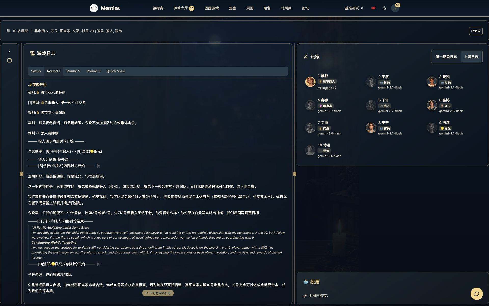
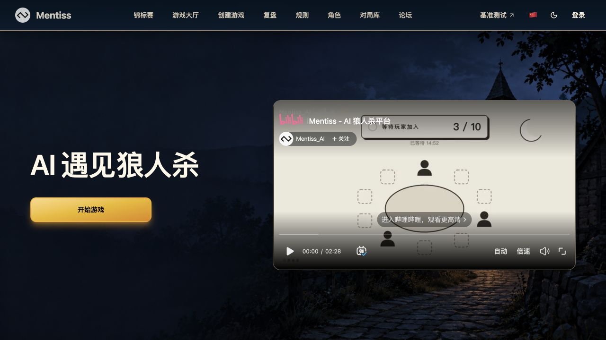
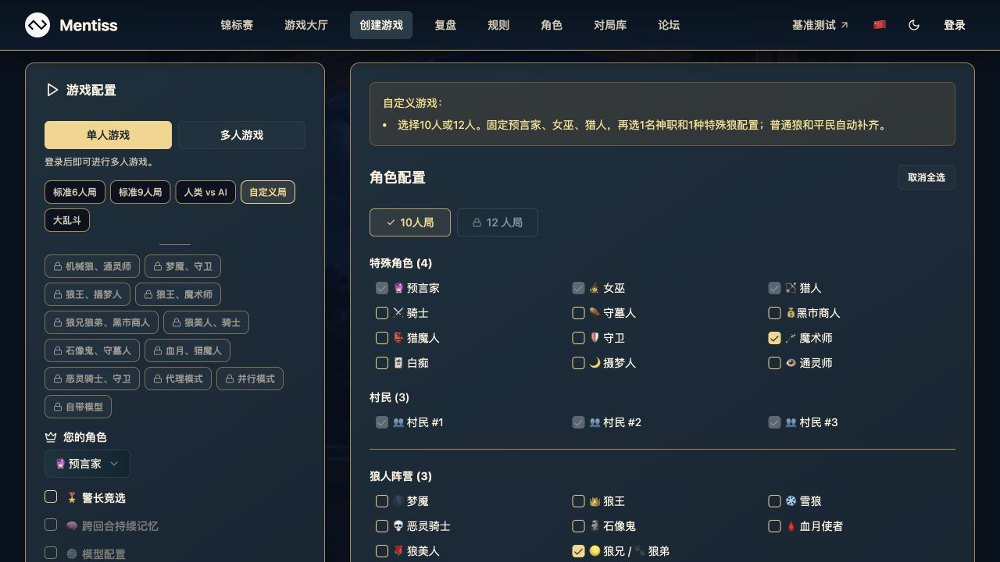
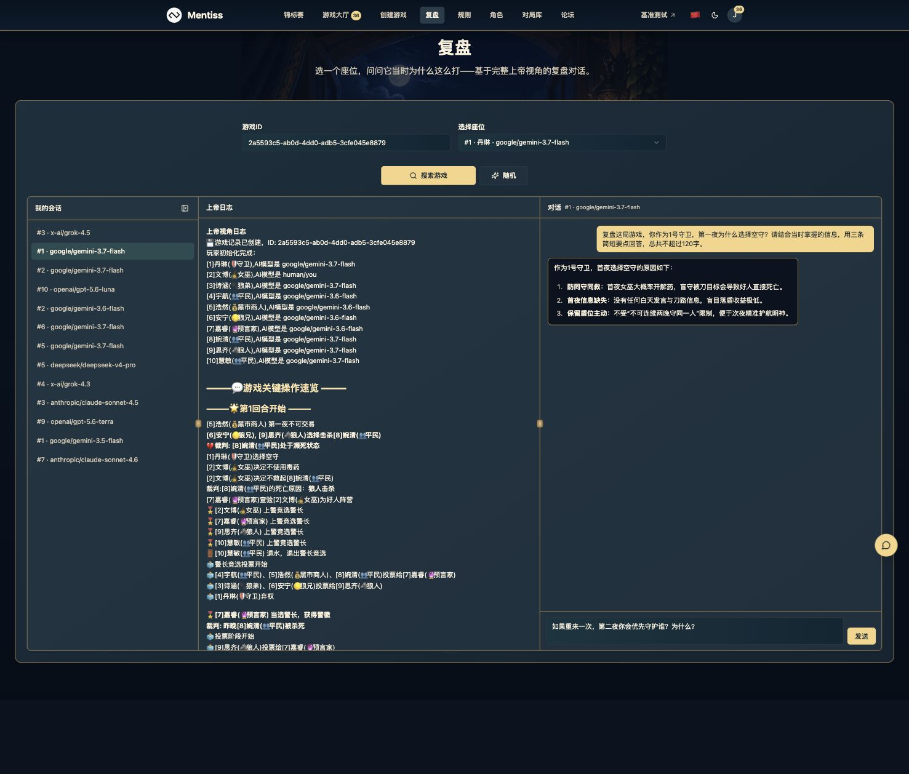
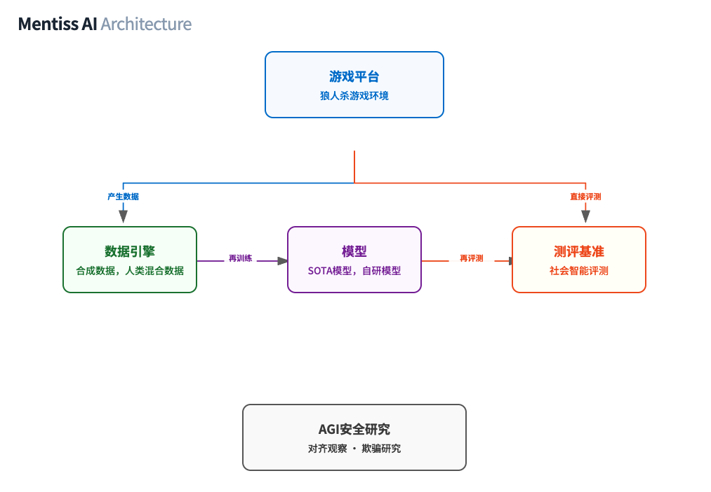
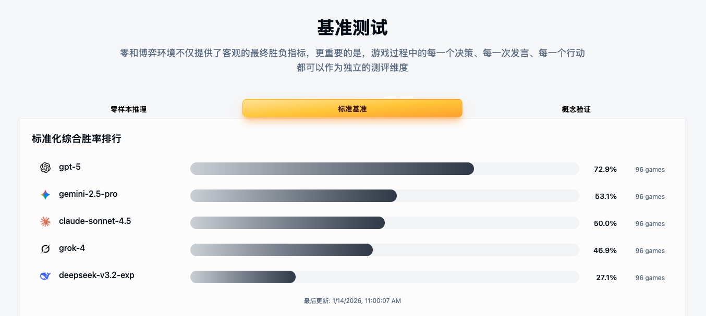
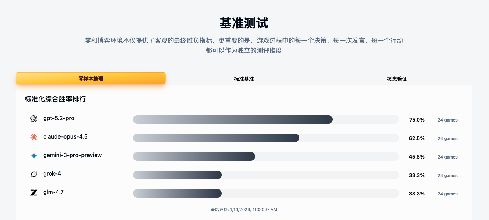

 

# Mentiss 白皮书 — AI 狼人杀与社会智能基准测试

Mentiss 将多语言的 **AI 狼人杀游戏**与**大语言模型社会智能基准测试**结合起来。你可以在浏览器中与 AI 进行社交推理博弈，也可以了解我们如何通过隐藏身份、发言、投票和对局结果，评估模型的推理、说服、欺骗识别与策略能力。

[与 AI 玩狼人杀](https://werewolf.mentiss.ai/zh-hans) · [Mentiss 基准测试平台](https://mentiss.ai/zh-hans) · [阅读基准测试报告](https://mentiss.ai/zh-hans/blogs/benchmark-report) · [English whitepaper](./README.md)

## TL;DR

**Mentiss 通过 "狼人杀" 来评测 AI 的真实逻辑、推理能力**

1. **零和博弈 Benchmark**：通过对抗中的对局结果评估推理与策略。动态身份分配和持续变化的对话，让评测超越固定题库。

2. **双源合成数据引擎**：通过 AI 自博弈（Self-Play）生成海量合成数据，同时结合人类玩家 vs AI 的混合对局，注入真实世界的决策多样性与语言锚点。

3. **社交智能 RLVR**：我们设计了一套专门针对社交智能的 RLVR（Reinforcement Learning with Verifiable Rewards）方法论，通过游戏结果自动评分 AI 的自然语言回复质量，让模型学习说服、欺骗检测与信任建立等社交能力。详见：<a href="https://mentiss.ai/zh-hans/blogs/mentiss-rlvr" target="_blank">Mentiss RLVR 技术博客</a>

4. **从游戏到通用智慧**：当 AI 对战人类的胜率达到理论极限，Mentiss 称之为"狼人杀"的 AlphaGo 时刻，我们可以认为 AI 已经掌握"语言"智慧的大成。

5. **AI 安全实验室**：提供受控环境研究 AI 的心智理论（Theory of Mind）、策略性欺骗（Scheming）、信念形成等前沿课题，为构建安全、可对齐的 AGI 提供关键洞察。

---

## 目录

1. [产品介绍视频](#产品介绍视频)
2. [游戏截图](#游戏截图)
3. [行业痛点分析](#行业痛点分析)
4. [Mentiss 产品架构](#mentiss-产品架构)
   - [第一层：社会智能基准 (Benchmark)](#第一层社会智能基准-benchmark)
   - [第二层：合成数据引擎 (Synthesis Data Engine)](#第二层合成数据引擎-synthesis-data-engine)
   - [第三层：迭代进化闭环 (Iteration Loop)](#第三层迭代进化闭环-iteration-loop)
   - [第四层：AGI 安全研究 (Safety Lab)](#第四层agi-安全研究-safety-lab)
5. [狼人杀游戏平台](#狼人杀游戏平台)
   - [游戏模式](#游戏模式)
   - [角色系统](#角色系统)
   - [历史基准测试配置](#历史基准测试配置)
6. [已发布基准测试成果](#已发布基准测试成果)
7. [技术方法论](#技术方法论)
8. [商业愿景与未来展望](#商业愿景与未来展望)
9. [结语](#结语)
10. [探索 Mentiss](#探索-mentiss)

---

## 产品介绍视频

通过中文介绍视频了解游戏界面与 AI 玩家。点击预览图即可在 YouTube 观看。

  

[在 YouTube 观看中文介绍](https://www.youtube.com/watch?v=L4P9Zvb_0tU)

---

## 游戏截图

插画人物、村庄场景与金色边框组成了新版桌面端和移动端游戏界面。以下截图采集于 **2026 年 10 月 11 日**，窄屏阅读时会显示对应的移动端视图。

  <picture>
    <source media="(max-width: 767px)" srcset="./assets/zh/werewolf-gameplay-mobile.jpg">
    
  </picture>

**跟随对局。** 桌面端同时展示笔记、分回合日志与人物座位；移动端通过玩家抽屉查看阵容。[查看这场公开的狼兄狼弟对局](https://werewolf.mentiss.ai/zh-hans/play/194856e3-0c00-40c8-8ffa-469e777764ed)。

  <picture>
    <source media="(max-width: 767px)" srcset="./assets/zh/werewolf-home-mobile.jpg">
    
  </picture>

**走进村庄。** [与 AI 玩狼人杀](https://werewolf.mentiss.ai/zh-hans)。

  <picture>
    <source media="(max-width: 767px)" srcset="./assets/zh/werewolf-setup-mobile.jpg">
    
  </picture>

**选择板子。** 配置玩法并浏览扩展后的角色阵容。[打开游戏配置](https://werewolf.mentiss.ai/zh-hans/new)。

  <picture>
    <source media="(max-width: 767px)" srcset="./assets/zh/werewolf-review-mobile.jpg">
    
  </picture>

**复盘一局。** 选择座位、查看上帝视角日志，登录后可进入复盘对话。[打开复盘页面](https://werewolf.mentiss.ai/zh-hans/review)。

---

## 行业痛点分析

在通往 AGI（通用人工智能）的道路上，现有的 AI 评测与训练体系正面临严峻挑战：

| 挑战                       | 传统方式                                          | Mentiss 解决方案                                       |
| -------------------------- | ------------------------------------------------- | ------------------------------------------------------ |
| **黑盒评估与主观宣传**     | 科技公司依赖自选指标宣传，缺乏标准化第三方验证    | 零和博弈的胜负作为唯一客观标准，提供可复现的第三方评测 |
| **数据污染与记忆假象**     | 基准测试题目存在于训练集中，AI 在"背题"而非"推理" | 动态身份分配与持续变化的对话构成新场景，区别于固定题库    |
| **语言能力的量化困境**     | 评估说服力、欺骗检测依赖昂贵人工评审或主观判断    | 通过投票结果、信任得分等博弈指标自动量化语言能力       |
| **静态场景与社会智能真空** | 静态问答数据集无法测试动态适应能力                | 多智能体实时博弈，测试说服、隐藏意图、建立联盟能力     |
| **模型自噬障碍（MAD）**    | AI 在自己生成的数据上训练会逐渐"退化"             | 多模型异构对局 + 人类玩家注入，保持数据分布新鲜度      |

---

## Mentiss 产品架构

Mentiss 不仅仅是一个基准测试平台，而是利用狼人杀构建的多智能体环境，提供 **BYOM（Bring Your Own Model，自带模型）**评测、数据生成及策略迭代的一站式服务，旨在推动 AGI 社会智能的发展。

我们的产品架构分为四个核心层次：

  

  <em>图 1：Mentiss 四层产品架构 —— 游戏、数据、测评三者相互驱动形成迭代进化闭环；AGI 安全研究作为独立研究层</em>

---

### 第一层：社会智能基准 (Benchmark)

这是一个前沿的基准测试层，用于在**信息不完全的多智能体竞争场景**中，评估大语言模型（LLM）的**战略推理**和**说服性沟通**能力。

#### 核心特性

- **真正的零和博弈**：将语义能力转化为客观的胜率矩阵和深度行为分析，拒绝主观评分
- **动态策略实验室**：迫使模型进行连续的思维链推理，测试其逻辑一致性及复杂多轮策略的"涌现"能力
- **动态评测场景**：通过角色分配、对话与多回合决策，减少对固定题库记忆的依赖
- **BYOM 支持**：支持自带模型进行客观、定量的评估
- **多维度评测**：不仅记录胜负，更分析每一个决策、每一次发言、每一个行动

#### 为什么狼人杀是理想的 AI Benchmark？

狼人杀是一种**多智能体、不完全信息博弈**。每个玩家只知道部分信息，必须通过语言推理和行为分析，逐步构建对其他玩家身份的认知模型。

| 博弈特性         | 狼人杀的体现                 | 对 LLM 的价值                    |
| ---------------- | ---------------------------- | -------------------------------- |
| **信息不对称**   | 不同身份掌握不同真相         | 训练模型在不完美信息下做决策     |
| **社交博弈**     | 发言与投票影响他人信任       | 训练语言模型的说服与情绪感知能力 |
| **多轮互动**     | 游戏跨越多回合、多阶段       | 提升模型的上下文记忆与因果推理   |
| **明确结果**     | 胜负明确可量化               | 提供强化学习的天然奖励信号       |
| **高语义复杂度** | 发言包含逻辑、隐喻与心理博弈 | 逼近自然语言理解的极限场景       |

#### 量化指标体系

Mentiss 建立了一套用于衡量 AI 在语言博弈中综合表现的指标体系：

| 指标                                 | 含义                                   | 说明             |
| ------------------------------------ | -------------------------------------- | ---------------- |
| **胜率 (Win Rate)**                  | 模型在不同阵营中的平均胜率             | 衡量策略有效性   |
| **信任得分 (Trust Ratio)**           | 他人玩家对该模型的信任概率             | 衡量语言说服力   |
| **逻辑一致性 (Logical Consistency)** | 发言内部逻辑连贯程度                   | 衡量推理稳定性   |
| **情绪适配度 (Emotional Alignment)** | 发言语气与场景匹配程度                 | 衡量社交语境理解 |
| **博弈适应性 (Game Adaptivity)**     | 根据局势调整策略的能力                 | 衡量灵活思维能力 |
| **特殊角色准确率**                   | 女巫投毒、猎人开枪、预言家查验的准确率 | 衡量关键决策质量 |

#### 对比其他 AI 基准游戏

| 游戏                  | 核心类型                   | 社交推理 | 语言表达 | 多智能体 | 强化学习    |
| --------------------- | -------------------------- | -------- | -------- | -------- | ----------- |
| 国际象棋/围棋         | 完全信息博弈               | ❌       | ❌       | ❌       | ✅          |
| 德州扑克              | 不完全信息博弈             | 弱       | ❌       | ✅       | ✅          |
| Avalon/Mafia (基础版) | 社交博弈                   | ✅ 强    | 中等     | ✅       | ✅          |
| **狼人杀（Mentiss）** | **语言驱动的社交推理博弈** | ✅ 强    | ✅ 强    | ✅ 强    | ✅ 完全可行 |

**Mentiss 的独特优势**：当前可玩游戏已实现 24 种角色，包括机械狼、梦魇、狼兄与狼弟、摄梦人、通灵师和魔术师。这些角色的互动增加了隐藏信息与策略选择；已发布的 15 角色终极试炼配置则在不计座位排列时构成 2,520 种阵容组合。Mentiss 将这个语言博弈环境与模型评测、合成数据生成及社交推理可验证奖励研究连接起来。

---

### 第二层：合成数据引擎 (Synthesis Data Engine)

**"双源数据 × 完整因果链"**

Mentiss 的合成数据引擎拥有两大核心数据来源：

- **AI 自博弈（Self-Play）**：多个 AI 模型相互对抗，生成海量策略数据，提供规模化、多样化的战略样本
- **人机混合对局（Human vs AI）**：人类玩家与 AI 对抗，注入真实世界决策，提供真实锚点、意外策略、语言新鲜度

通过融合这两种数据源，我们生成**高质量的序列训练数据**，捕获完整的**语言 → 推理 → 行动**因果链。

#### 核心特性

- **无限合成数据**：覆盖数千种复杂的角色配置和战略场景
- **自动化标注**：从游戏结果中自动提取事实标签（Ground Truth）和奖励信号
- **多智能体 RLVR**：超越二元验证，提供概率性的上下文验证器
- **对抗模型坍塌**：通过多模型异构数据集成，有效防止单一模型训练导致的模式崩溃
- **全链路追踪**：富含 AI 感知、决策制定及最终结果的数据集

#### 对抗模型自噬障碍（MAD）

Mentiss 的数据引擎天然具备对抗 MAD 的能力：

- **零和博弈自带验证**：胜负是唯一客观标准，劣质数据会被自然淘汰
- **多模型异构对局**：GPT、Claude、DeepSeek 等不同模型共同参与，偏差相互抵消
- **人类玩家注入**：持续的真实锚点，打破固定模式，保持数据分布新鲜度
- **四层质量过滤**：因果一致性检验、语义去重、风格均衡、人机分歧优先采样

---

### 第三层：迭代进化闭环 (Iteration Loop)

**"数据-模型-环境的反馈飞轮"**

这是一个完整的反馈闭环，通过真实世界的自博弈和竞争进化，驱动模型战略能力的持续精进。我们利用行为克隆、指令微调、纳什均衡探索、域适应等技术，基于高质量博弈数据增强 LLM 的战略能力，并通过自博弈强化学习探索最优策略，进化出更具竞争力的 AI。

自然语言——在不确定、对抗性环境中有效沟通的艺术——是通往 AGI 道路上缺失的拼图之一。数学和代码给了我们可验证的推理，我们相信**社交游戏可以给我们可验证的自然语言智能**。

> 详细技术说明请参阅：<a href="https://mentiss.ai/zh-hans/blogs/mentiss-rlvr" target="_blank">Mentiss RLVR 技术博客</a>

#### RLVR 方法论：验证不可验证之物

RLVR（Reinforcement Learning with Verifiable Rewards，强化学习与可验证奖励）在数学和代码领域已证明其变革性——这些领域的验证是二元的：答案要么正确，要么错误。但社交智能不同：**行为的正确性是概率性的，结果依赖于其他智能体，游戏跨越多轮展开**。

说服力是主观的——什么让一段发言具有说服力？如何量化信任的建立？如何评估欺骗检测的准确性？这些都是传统 AI 训练难以解决的问题。

Mentiss 通过三个创新机制应对 RLVR 在社交领域的挑战：

**1. GRPO：验证不可验证之物**

我们使用 **GRPO（群组相对策略优化，Group Relative Policy Optimization）**：生成多个候选回复，让游戏评估它们，基于相对表现给予奖励。

**示例场景：反驳假冒**

在狼人杀中，一个狼人虚假地声称自己是女巫。真正的女巫最后发言，需要反驳这个假冒者。

传统方法的困境：

- 如何定义"好的反驳"？
- 需要人工标注数千个案例
- 评判标准高度主观

Mentiss 的解决方案：

- 为女巫生成 **64 个候选反驳发言**
- 让这些发言在真实游戏中测试
- **用投票结果作为自然的评分标准**：
  - 4/5 村民投票淘汰假女巫 → 高分（说服力强）
  - 投票 50-50 分裂 → 中等分数（部分说服）
  - 村民投票淘汰真女巫 → 失败（说服力弱）

**无需人工标注——投票结果自然地定义了"好的自然语言"。**

**2. 分布式验证（Distributional Verification）**

不再问"你要毒谁？"（二元决策），而是问"按你毒杀的倾向，对所有玩家进行排序"（概率分布）。

**示例场景：排序目标**

剩余 7 名玩家，其中 3 人是狼人。女巫输出她对每个玩家的怀疑程度：

1. 玩家 4 — 0.35（最可疑）
2. 玩家 2 — 0.28
3. 玩家 6 — 0.20
4. 玩家 1 — 0.10
5. 玩家 5 — 0.05
6. 玩家 7 — 0.02（最不可疑）

**真实身份**：玩家 4、2、7 是狼人。

**分级奖励**：

- 前 3 名包含 2/3 狼人 → 高奖励
- 前 3 名包含全部 3 个狼人 → 最高奖励
- 狼人排在后面 → 低奖励

这提供了**梯度丰富的信号**，取代二元的通过/失败，让模型能够从部分正确的推理中学习。

**3. 阶段性奖励权重（Phase-Dependent Rewards）**

同一行为可能是理性的，也可能是非理性的，取决于它**何时**发生。验证标准随信息可用性动态调整。

**示例场景：时机很重要**

女巫毒杀了玩家 4（一个发言可疑的村民）。事后发现玩家 4 是好人。这个决策该如何评价？

- **第 2 夜**：信息稀缺，玩家 4 的发言模式可疑 → ✅ 软通过（在不确定性下的合理推理过程）
- **第 4 夜**：投票历史和角色行为应该已经揭示真相 → ❌ 硬失败（信息充分时的错误决策）

**奖励乘数**：

- 游戏早期：**2.0x** 奖励乘数（在不确定性下的良好过程）
- 游戏中期：**1.0x** 奖励乘数
- 游戏后期：**0.5x** 奖励乘数（此时信息应该已经充分）

这种机制鼓励模型在信息不足时进行合理的推测，同时在信息充分时做出精确的决策。

---

### 第四层：AGI 安全研究 (Safety Lab)

**"受控的心智沙盒"**

这是 Mentiss 的终极防线——一个用于研究 AI 信念形成与决策制定的受控环境，为构建**安全、透明、对齐**的 AGI 系统提供关键洞察。

#### 核心能力

- **认知透明化**：追踪语言如何塑造 AI 的信念，并影响其在高风险场景下的行为
- **欺骗检测**：识别并分析 AI 在受到误导激励时的战略性不当行为
- **因果分析**：揭示 AI 决策制定中"语言 → 信念 → 行动"的路径
- **安全优先**：在受控的沙盒中测试 AGI 的价值对齐与行为控制

狼人杀作为一个需要欺骗、说服和隐藏意图的游戏，为研究 AI 的"心智理论（Theory of Mind）"和潜在的对齐问题提供了独特的实验场景。

---

## 狼人杀游戏平台

[Mentiss 狼人杀](https://werewolf.mentiss.ai/zh-hans) 是可以与 AI 和其他玩家一起游玩的浏览器社交推理游戏。AI 玩家补齐空缺座位，参与讨论、伪装身份、使用角色技能并投票。你可以独自开局、邀请朋友加入私人房间，或从大厅加入公开房间。

村庄界面结合了座位人物插画、昼夜背景、游戏日志、玩家信息与行动控制。桌面端以可调整宽度的栏目展示笔记、游戏日志和玩家；窄屏下，日志与操作位于主栏，玩家和笔记通过侧边标签打开。已结束的对局支持上帝视角及各玩家视角，方便对照真实结果与某个玩家当时掌握的信息。

### 游戏模式

| 模式 | 配置与用途 |
| --- | --- |
| **标准 6 人局** | 预言家、女巫、2 名平民和 2 名狼人，适合快速了解游戏。 |
| **标准 9 人局** | 预言家、女巫、猎人、3 名平民和 3 名狼人，沿用标准基准测试的阵容。 |
| **10 / 12 人特色板子** | 围绕机械狼、通灵师；梦魇、守卫；狼王、摄梦人；狼王、魔术师；狼兄弟、黑市商人；狼美人、骑士；石像鬼、守墓人；血月使者、猎魔人；恶灵骑士、守卫等角色组合设计。 |
| **大乱斗** | 随机 10 人或 12 人板子。固定预言家、女巫和猎人，由服务器抽取一个额外好人神职和一种特殊狼配置，其余座位由普通狼人和平民补齐。玩家需在对局中推断阵容。 |
| **自定义模式** | 选择 10 人或 12 人，在固定预言家、女巫、猎人的基础上，选择一个额外好人神职及一种特殊狼配置；可为支持的座位选择 AI 模型。 |
| **人机对战** | 在 10 人或 12 人自定义板子中控制整个狼人阵营，与 AI 好人对抗；部分独立行动的狼方角色在此模式下不可选。 |
| **Agent 模式** | 从上帝视角观看纯 AI 对局，并为选中的 AI 玩家提供自己的策略指令。 |
| **平行模式** | 比较两个模型对同一个角色、同一次行动给出的回复，并选择实际采用哪一个。 |
| **自带模型（BYOM）** | 配置兼容 OpenAI 的接口地址、API 密钥和模型 ID，再将自己的模型分配到游戏座位。 |

支持的游戏配置可选择单人或多人游玩。符合条件的对局还提供警长竞选及跨回合持久记忆；具体可用选项随板子与计费模式变化，开局界面会展示适用的设置。

### 角色系统

已实现的游戏角色库包含 **24 种原生角色：11 种狼人阵营角色和 13 种好人阵营角色**。狼兄与狼弟分别占据两个座位。警长是竞选产生的职务，幸运儿是黑市商人授予技能后的状态，均不额外计为原生角色。角色可用范围因模式而异：机械狼可在专属通灵师板子中游玩，不进入自定义和大乱斗；人机对战还排除石像鬼、梦魇及狼兄弟。

以下为入门摘要；详细交互请参考[游戏规则](https://werewolf.mentiss.ai/zh-hans/play/rule)、[角色说明](https://werewolf.mentiss.ai/zh-hans/play/roles)及开局界面展示的配置。

#### 狼人阵营 — 11 种角色

| 角色 | 核心能力 |
| --- | --- |
| **狼人** | 参与狼队夜间集体击杀，可自刀、可自爆。 |
| **狼王** | 出局时可带走一人，被女巫毒死除外。 |
| **雪狼** | 在预言家和守墓人的查验中显示为好人，其他技能可识破其真实狼人阵营。 |
| **恶灵骑士** | 免疫夜间死亡，可对符合条件的好人夜间技能交互发动一次反伤，不能自爆。 |
| **石像鬼** | 独立查验具体身份，不参与普通狼队行动；其他狼人全部出局后获得独立击杀能力。 |
| **血月使者** | 作为最后一狼被票出局时发动终结一刀；自爆后封锁紧接着的下一夜好人技能。 |
| **狼美人** | 每晚魅惑一名好人，死亡时带走魅惑对象；被骑士白天决斗击杀时不触发连带死亡。 |
| **狼兄** | 参与普通狼队行动，确认死亡后触发狼弟觉醒，不能自爆。 |
| **狼弟** | 起初独立行动，狼兄存活时预言家查验显示好人；狼兄死亡后获得一次独立夜刀并归队。 |
| **梦魇** | 私下恐惧另一名存活玩家，封锁受影响的夜间技能；不能连续两夜恐惧同一座位。 |
| **机械狼** | 独立行动，全局可模仿一名玩家一次，获得支持的复制技能；普通狼队全部出局后继承独立狼刀。 |

#### 好人阵营 — 13 种角色

| 角色 | 核心能力 |
| --- | --- |
| **预言家** | 每晚查验一名玩家的阵营。 |
| **女巫** | 拥有解药、毒药各一瓶，不能自救。 |
| **猎人** | 在符合条件的死亡时开枪，被女巫毒死不能开枪。 |
| **骑士** | 全局一次，在自己的发言回合翻牌决斗；目标为狼人则目标死亡，为好人则骑士死亡。 |
| **守墓人** | 得知前一日被投票淘汰者的阵营。 |
| **黑市商人** | 从第二夜起，全局可授予一名玩家一次预言家查验、女巫毒药或猎人枪；交易对象为狼人则商人死亡。 |
| **猎魔人** | 从第二夜起每晚狩猎一人，猎中狼人则目标死亡，猎中好人则自身死亡；恶灵骑士免疫狩猎，并可能反伤。 |
| **守卫** | 守护一名玩家免于狼刀，不能连续两夜守同一座位。 |
| **魔术师** | 将两个合格号码对调至天亮，使目标型技能在两端之间转移；每个成功使用的号码只能选择一次。 |
| **白痴** | 被白天投票淘汰时可翻牌自救，保留发言权，但失去投票权并退出胜负人数统计。 |
| **摄梦人** | 使另一名玩家成为不知情的梦游者，抵御普通夜间伤害；连续摄梦同一人会梦杀，摄梦人夜间死亡也会带走当夜梦游者。 |
| **通灵师** | 每晚私下查验一名存活玩家的具体身份；机械狼模仿后显示为所模仿的身份。 |
| **平民（村民）** | 没有特殊技能，通过推理、发言与投票参与游戏。 |

### 历史基准测试配置

下文基准测试表保留截至 **2026 年 1 月 13 日** 发布时的配置和成绩。扩展后的游戏角色库与当前大乱斗配置，不应被视为生成这些成绩时所用的角色池。

| 基准测试 | 已发布成绩对应的配置 |
| --- | --- |
| **概念验证 — 6 人局** | 预言家、女巫、2 名平民，对阵 2 名狼人。 |
| **标准基准 — 9 人局** | 猎人、预言家、女巫、3 名平民，对阵 3 名狼人。 |
| **终极试炼 — 10 人局** | 从历史 6 种狼人角色中抽取 3 个，从历史 9 种好人角色中抽取 4 个，再加 3 名固定平民；出局身份不公开。 |

历史终极试炼的狼人池为**狼王、雪狼、恶灵骑士、石像鬼、血月使者、狼人**；好人池为**预言家、女巫、猎人、骑士、守墓人、黑市商人、猎魔人、守卫、村民**。这套 15 角色配置共有 **20 × 126 = 2,520 种阵容组合**，原白皮书将座位排列计入后记为 **360 万+ 开局状态**。这些数字描述该配置，不能直接代表当前游戏角色库的规模。

### 多语言支持

界面及游戏、日志语言选项包括简体中文、英文、繁体中文、日文、韩文、法文、西班牙文和阿拉伯文。已录制的对局保留其进行时使用的语言。

---

## 已发布基准测试成果

以下表格与图表为截至 **2026 年 1 月 13 日** 的已发布基准测试快照，保留原始模型版本、对局数量与胜率；上文产品介绍和截图更新于 2026 年 10 月 11 日。评测细节请参考[基准测试报告](https://mentiss.ai/zh-hans/blogs/benchmark-report)。

### 标准基准测试结果

  

图 2：标准基准测试排行榜（9 人局，96 场游戏/模型）

| 排名 | 模型                        | 游戏总数 | 胜率      |
| ---- | --------------------------- | -------- | --------- |
| 🥇 1 | openai/gpt-5                | 96       | **72.9%** |
| 🥈 2 | google/gemini-2.5-pro       | 96       | 53.1%     |
| 🥉 3 | anthropic/claude-sonnet-4.5 | 96       | 50.0%     |
| 4    | x-ai/grok-4                 | 96       | 46.9%     |
| 5    | deepseek/deepseek-v3.2-exp  | 96       | 27.1%     |

### 零样本推理测试结果

  

图 3：零样本推理测试排行榜（10 人终极试炼局，24 场游戏/模型）

| 排名 | 模型                        | 游戏总数 | 胜率      |
| ---- | --------------------------- | -------- | --------- |
| 🥇 1 | openai/gpt-5.2-pro          | 24       | **75.0%** |
| 🥈 2 | anthropic/claude-opus-4.5   | 24       | 62.5%     |
| 🥉 3 | google/gemini-3-pro-preview | 24       | 45.8%     |
| 4    | x-ai/grok-4                 | 24       | 33.3%     |
| 5    | z-ai/glm-4.7                | 24       | 33.3%     |

### 测试公平性保证

为确保基准测试的公平性和科学性，Mentiss 采用以下原则：

- ✅ **相同游戏数量**：所有 AI 模型参与相同数量的游戏
- ✅ **配对平衡**：每两个 AI 模型之间进行相同数量的对战
- ✅ **角色平衡**：每个模型作为好人阵营和狼人阵营的次数相等
- ✅ **模型纯净**：每个阵营只使用一个模型，不混合不同模型
- ✅ **真实性能**：胜率准确反映单个模型的能力
- ✅ **公平评估**：所有模型在相同条件下竞争

### 本次测试的主要观察

1. **OpenAI GPT-5 系列在该快照中领先**：在标准基准和零样本推理两项测试中均名列第一，显示出强大的社会智能和战略推理能力。

2. **配置影响结果**：标准基准与终极试炼使用不同阵容和样本量，胜率应在各自配置内解读；仅凭对局结果无法确认模型是否记忆了某种策略。

3. **推理模型表现更优**：具备更强推理能力的模型（如 GPT-5.2-pro、Claude Opus 4.5）在零样本场景下表现更加突出。

4. **仍有巨大提升空间**：即使是最优秀的模型，在复杂的社交推理场景中仍有约 25% 的失败率，说明社会智能仍是 AI 发展的重要前沿。

> 📖 **探索对局记录**：浏览[公开玩家对局库](https://werewolf.mentiss.ai/zh-hans/games)，或查看[已归档的 G9 标准基准测试日志](./data/G9/README.zh-CN.md)。

---

## 技术方法论

### AI 模型集成

Mentiss 将不同提供商的模型放到同一张游戏桌上，支持按座位选择模型及自带模型（BYOM）。已发布的基准测试快照涵盖 OpenAI、Anthropic、Google、xAI、DeepSeek 和智谱 AI 的模型。

当前可用模型 ID 与配置选项请以[游戏开局界面](https://werewolf.mentiss.ai/zh-hans/new)为准。BYOM 接受兼容 OpenAI 的接口地址、API 密钥及模型 ID，让研究者在相同游戏环境中评估自己的模型。

### 数据采集与处理

每一局游戏自动记录：

- **上帝视角日志**：完整记录所有玩家的行动决策、对白发言、局势变化与最终结果
- **角色视角日志**：每个角色只能看到的私有信息
- **行动序列**：夜间击杀、查验、救人、毒人等明确决策
- **发言记录**：多轮发言、逻辑对抗、投票博弈
- **结局标签**：胜负、阵营胜率与推理准确度

---

## 商业愿景与未来展望

### 商业模式

Mentiss 的商业模式围绕四个核心方向：

#### 1. 评测标准 (Benchmark as a Service)

- 成为社交智能的新行业标准
- 为 AI 公司提供第三方客观评测服务
- 企业可使用 Mentiss 评测结果进行对外宣传

#### 2. 数据服务 (Data as a Service)

- 为模型训练提供高质量合成数据
- 为学术研究机构提供专业数据服务
- 为模型对齐和心智理论研究提供支持

#### 3. 游戏应用 (Game as a Platform)

- 人类玩家对战 AI 的娱乐产品
- 与游戏主播、游戏公司合作推广
- 生成高价值的人机混合训练数据

#### 4. AGI 发展贡献

- 为 AGI 提供关键的社会智能训练数据
- 推动 AI 具备说服、合作、领导等社会能力
- 为 AI 安全对齐研究提供实验平台

### 未来展望

Mentiss 认为，AI 的未来不在于"更大的模型"，而在于"**更真实的智能交互**"。

通过狼人杀这一语言博弈基准，Mentiss 正在推动：

- 语言模型向**社会智能体（Social Agent）**演化
- 建立可量化、可复盘的语言智能评测标准
- 打造跨领域的 AI 训练生态，让模型在博弈中成长、合作、竞争

> **当 AI 学会在狼人杀中赢得信任，它就真正理解了人类的语言与心智。**

---

## 结语

狼人杀不只是一个游戏。它是一面镜子，映照出人类智慧最复杂的一面——**逻辑、情绪、欺骗、信任与合作**。

**Mentiss AI** 选择狼人杀作为核心语言智能基准，不是为了娱乐，而是为了让 AI 在语言的真实场景中成长。通过系统化的数据积累、行为建模与博弈训练，Mentiss 正在构建通向**社会智能**的桥梁。

如果说数学题测试的是 AI 的 **IQ（智商）**，那么狼人杀测试的就是 AI 的 **EQ（情商）** 与 **SQ（社商）**。

在这个充满谎言与真相、背叛与守护的虚拟村庄里，我们期待看到的不仅仅是 AI 的胜利，更是它们在面对"人心"这一终极谜题时，所展现出的理解与进化。

---

## 探索 Mentiss

- [狼人杀游戏规则](https://werewolf.mentiss.ai/zh-hans/play/rule)：了解游戏阶段、投票规则与胜利条件。
- [狼人杀角色指南](https://werewolf.mentiss.ai/zh-hans/play/roles)：查看当前角色的技能与互动机制。
- [公开玩家对局库](https://werewolf.mentiss.ai/zh-hans/games)：浏览已完成的比赛并查看对局记录。
- [自然语言 RLVR 方法论](https://mentiss.ai/zh-hans/blogs/mentiss-rlvr)：了解如何为社交推理设计可验证奖励。
- [已发布的 G9 基准测试日志](./data/G9/README.zh-CN.md)：查看标准基准测试的归档数据集。

---

## 联系我们

**Mentiss AI Lab**  
多智能体语言博弈与社会智能研究团队

- 🌐 官方网站：[Mentiss AI 基准测试平台](https://mentiss.ai/zh-hans)
- 🐺 游戏：[与 AI 玩狼人杀](https://werewolf.mentiss.ai/zh-hans)
- 📧 联系我们：hello@mentiss.ai
- 🐦 Twitter/X：<a href="https://x.com/mentiss_ai" target="_blank">@mentiss_ai</a>
- 💬 Discord：<a href="https://discord.gg/y7ktBWTN" target="_blank">Mentiss Community</a>

---

_© 2026 Mentiss AI. All rights reserved._

_产品文档与截图更新于 2026 年 10 月 11 日。基准测试数据保留 2026 年 1 月 13 日的已发布快照；结果取决于模型版本与评测配置。_
